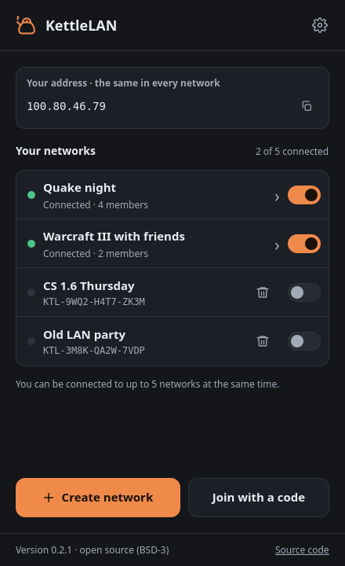
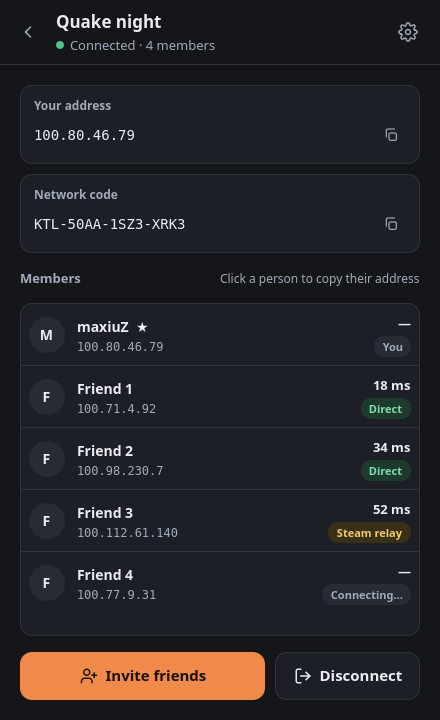
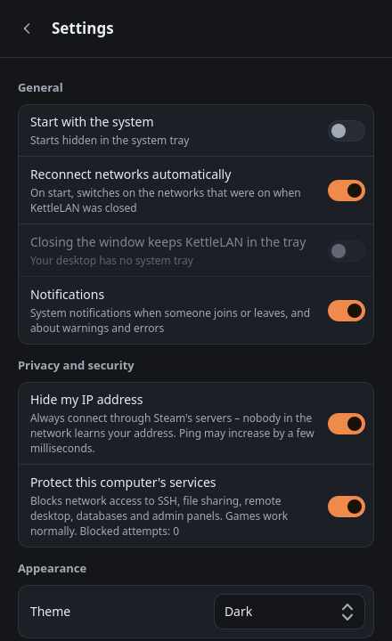

<div align="center">


# KettleLAN

**An open-source virtual LAN over the Steam network.**<br>
Play classic LAN games with your friends as if you were on the same router –<br>
no player limit, no port forwarding, no server of your own.

[](https://github.com/maxiuz94/kettlelan/actions/workflows/build.yml)
[](https://github.com/maxiuz94/kettlelan/releases/latest)
[](LICENSE)


&nbsp;
&nbsp;


</div>

## Why KettleLAN?

Old multiplayer games – Quake 3, Unreal Tournament, Counter-Strike 1.6, Warcraft III, Age of Empires II and
many more – were made for LAN parties. Tools like Hamachi recreate a LAN over the internet, but limit the
number of players on free plans or need you to run a server.

KettleLAN uses the network your friends already have: **Steam**. Traffic goes through Steam's encrypted
networking (directly or via Valve's relays), so it works behind any router and even behind carrier-grade NAT.

## Features

- **Networks with a permanent code** (`KTL-XXXX-XXXX-XXXX`) – create a network once and share the code.
  It works no matter who created it: the first person to connect opens it, everyone else joins.
- **No player limit**, no port forwarding, no account other than Steam.
- **A stable address** (`100.x.x.x`) for every player – click a person to copy their address for the game.
- **Up to five networks at the same time**, with one address – switch each one on and off on the home screen.
- **Saved networks**, automatic reconnect and start with the system – like Hamachi.
- **Private by default** – your IP address is hidden from other players and your computer's services
  (SSH, file sharing, remote desktop, databases…) are blocked for them.
- System tray icon, notifications, dark and light theme.
- Command-line version (`kettlelan-cli`) for diagnostics and SSH sessions.

## Download

Get the latest version from the [**Releases**](https://github.com/maxiuz94/kettlelan/releases/latest) page
([what's new](CHANGELOG.md)):

| System | File | How to install |
|--------|------|----------------|
| Any Linux distribution | `KettleLAN-…-x86_64.AppImage` | `chmod +x KettleLAN-*.AppImage`, then run it |
| Ubuntu 24.04+, Mint 22+, Pop!_OS, Debian 13 | `kettlelan_…_ubuntu24.04_amd64.deb` | `sudo apt install ./kettlelan_…_ubuntu24.04_amd64.deb` |
| Debian 12, MX Linux 23 | `kettlelan_…_debian12_amd64.deb` | `sudo apt install ./kettlelan_…_debian12_amd64.deb` |
| Windows 10/11 (64-bit) – from 0.2.0 | `KettleLAN-…-windows-x64.zip` | extract and run `KettleLAN.exe` (asks for administrator rights) |

You need **Steam** installed and signed in (on Linux the regular version from your distribution or from
Valve; the Flatpak and Snap versions may not work).

All files are built by GitHub Actions from this repository. Each release comes with SHA256 checksums and
a build attestation – see [Verifying a download](SECURITY.md#verifying-a-download).

> [!WARNING]
> **The Windows version is not code-signed yet.** Windows SmartScreen shows "Windows protected your PC"
> (click *More info* → *Run anyway*), and some antivirus programs may flag KettleLAN with a generic
> heuristic label (see the [FAQ](#faq)).
>
> **Download KettleLAN only from the [Releases page](https://github.com/maxiuz94/kettlelan/releases) of this
> repository.** Copies from other websites may be modified. Before running a file, check that its SHA256
> matches the one shown next to it on the Releases page.

## Quick start

1. Start Steam and sign in.
2. Start KettleLAN. The first time (and after every reboot) your system asks for the administrator
   password – this creates the virtual network adapter `kettle0`. KettleLAN itself runs as a normal user.
3. Click **Create network**, then **Invite friends** – the code is copied to the clipboard. Send it to your friends.
4. Your friends click **Join with a code**, paste the code and click **Join**.
5. Start a game server as you would on a LAN. Your friends connect to your address shown in KettleLAN
   (click a person on the list to copy their address).

The network is saved under **Your networks** – next time just switch it on. You can be in up to five networks
at the same time.

## How it works

- Every player gets a virtual network adapter with a stable address in `100.64.0.0/10`, derived from
  their Steam account. Games see an ordinary local network.
- A network is a Steam lobby found by a tag derived from the network code. Members prove that they know
  the network's key before any traffic is exchanged.
- Packets travel through Steam's networking: encrypted, authenticated with Steam certificates, directly or
  through Valve's relays.
- KettleLAN uses Valve's test App ID `480`, so your friends will see you as "playing Spacewar".

## Security and privacy

- **Your IP address is hidden by default** – traffic goes through Steam's relays, so other players never
  learn your public address (*Settings → Hide my IP address*).
- **Your computer's services are protected** – other players cannot reach SSH, file sharing, remote desktop,
  databases or admin panels; your computer does not announce its name and services to them
  (*Settings → Protect this computer's services*).
- Packets are accepted only from verified members and only with their own address – no spoofing.
- The program does not run as root; a tiny, strictly validated helper creates the network adapter.
- Attack scenarios, fuzzing and helper tests run on every change in CI.

Details and how to report a vulnerability: [SECURITY.md](SECURITY.md).

## FAQ

**Does the game have to support LAN?** Yes – KettleLAN creates a LAN, so the game needs a LAN or
"direct IP" multiplayer mode. Games that only use online matchmaking do not benefit.

**Windows asks "Allow access?" when I start a game server.** KettleLAN opens only UDP and ping in Windows
Firewall. Games that host over TCP (for example Minecraft or Warcraft III) trigger the standard Windows prompt
once – allow it for the game.

**The server does not show up in the game's LAN list.** Connect by typing the host's KettleLAN address
(`100.x.x.x`). LAN discovery over KettleLAN does not work in every game yet.

**Can I play with someone who is not my Steam friend?** Yes – anyone with the network code can join.

**Is there a player limit?** Steam lobbies allow up to 250 members.

**My antivirus or Windows SmartScreen warns about KettleLAN.** The Windows version is new and not yet
code-signed, and it does things that heuristic scanners treat as suspicious: it asks for administrator rights,
installs a network driver (Wintun), adds a firewall rule and a scheduled task for autostart. A single generic
detection (for example `Trojan.Malware.300983.susgen` from MaxSecure) is a known false-positive pattern for
new, unsigned programs. Make sure the file comes from the [Releases page](https://github.com/maxiuz94/kettlelan/releases)
and [verify it](SECURITY.md#verifying-a-download). If a well-known antivirus flags an official release,
please [open an issue](https://github.com/maxiuz94/kettlelan/issues) with the scan link – we report false
positives to the vendors.

**Why "Spacewar"?** It is Valve's free test App ID that every Steam account can use. A dedicated App ID
would require publishing KettleLAN on Steam.

## Building from source

Required packages:

| Distribution | Command |
|--------------|---------|
| Arch / Manjaro | `sudo pacman -S --needed base-devel cmake git polkit iproute2 qt6-base qt6-declarative` |
| Ubuntu 24.04+ / Debian 12+ | `sudo apt install build-essential cmake git pkexec iproute2 qt6-base-dev qt6-declarative-dev qml6-module-qtquick qml6-module-qtqml qml6-module-qtquick-controls qml6-module-qtquick-layouts qml6-module-qtquick-shapes qml6-module-qtquick-templates qml6-module-qtquick-window qml6-module-qtqml-workerscript` |
| Fedora | `sudo dnf install gcc-c++ cmake git polkit iproute qt6-qtbase-devel qt6-qtdeclarative-devel` |

Then:

```sh
git clone https://github.com/maxiuz94/kettlelan.git
cd kettlelan
./scripts/build.sh               # build and run the tests
./scripts/install-local.sh       # optional: add KettleLAN to your application menu
```

Building needs the **Steamworks SDK** (free, requires a Steam account). Valve's license does not allow
it in the repository – `build.sh` offers to open the download page and finds `steamworks_sdk_XXX.zip` in
your Downloads folder. Releases are built from the official SDK file listed in
[`cmake/steamworks-sdk.sha256`](cmake/steamworks-sdk.sha256)
(source: https://partner.steamgames.com/downloads/list).

Packages: `packaging/linux/build-appimage.sh` (AppImage) and `cpack` with `-DKETTLELAN_PACKAGE=deb` (.deb).

**Windows:** Visual Studio 2022 (C++ workload), CMake and Qt 6.8 for MSVC 2022 64-bit; in Git Bash run
`packaging/windows/build-zip.sh build-windows /path/to/steamworks_sdk_XXX.zip` – it builds, runs the tests and
creates the zip package. Wintun is downloaded automatically from wintun.net and verified with SHA256.
Releasing a new version: [docs/RELEASING.md](docs/RELEASING.md).

## Built with AI assistance

KettleLAN is developed with the help of **Claude**, an AI assistant made by
[Anthropic](https://www.anthropic.com). Most of the code, tests and documentation were written by Claude
following the maintainer's requirements and decisions. Every change was built, tested on real hardware
(Arch Linux with KDE Plasma, MX Linux with Xfce, two computers playing over KettleLAN) and checked by the
automated tests before being published.

If you find a bug or a security problem, please report it – see [SECURITY.md](SECURITY.md).

## License

KettleLAN is licensed under the **BSD 3-Clause License** – see [LICENSE](LICENSE).
It started as a fork of [PartyLAN](https://github.com/gyf304/partylan) by Yifan Gu (also BSD 3-Clause).

Components by other authors keep their own licenses – details in [THIRD-PARTY-NOTICES.md](THIRD-PARTY-NOTICES.md):

| Component | License |
|-----------|---------|
| Steam library (`libsteam_api.so`) | Valve proprietary, shipped under the Steamworks SDK Access Agreement |
| Qt 6 | LGPL-3.0 – system library in the .deb packages, bundled in the AppImage |
| Libraries bundled in the AppImage | their own open-source licenses, listed inside the AppImage |

Steam and the Steam logo are trademarks of Valve Corporation. KettleLAN is not affiliated with or
endorsed by Valve. Game names are trademarks of their respective owners.
