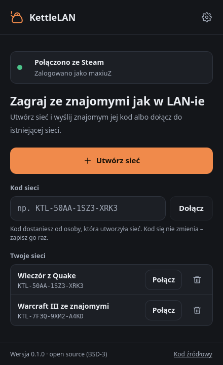
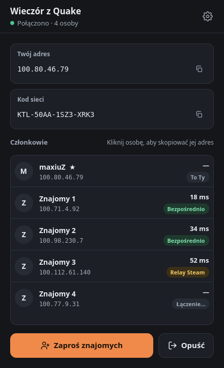
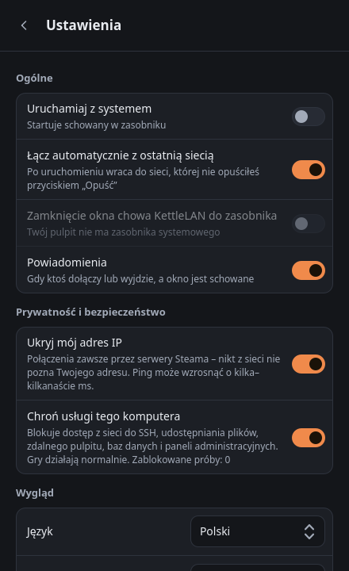

<div align="center">


# KettleLAN

**Otwartoźródłowy wirtualny LAN przez sieć Steam.**<br>
Graj ze znajomymi w gry LAN tak, jakbyście siedzieli przy jednym routerze –<br>
bez limitu osób, bez przekierowywania portów i bez własnego serwera.

[](https://github.com/maxiuz94/kettlelan/actions/workflows/build.yml)
[](https://github.com/maxiuz94/kettlelan/releases/latest)
[](LICENSE)


[English](README.md) · **Polski**

&nbsp;
&nbsp;


</div>

## Po co KettleLAN?

Klasyczne gry wieloosobowe – Quake 3, Unreal Tournament, Counter-Strike 1.6, Warcraft III, Age of Empires II
i wiele innych – powstały z myślą o grze w sieci lokalnej. Programy w rodzaju Hamachi odtwarzają LAN przez
internet, ale w darmowych wersjach ograniczają liczbę osób albo wymagają własnego serwera.

KettleLAN korzysta z sieci, którą Twoi znajomi już mają: **Steama**. Ruch idzie przez szyfrowaną sieć Steam
(bezpośrednio albo przez serwery pośredniczące Valve), więc działa za każdym routerem, nawet za NAT-em operatora.

## Funkcje

- **Sieci ze stałym kodem** (`KTL-XXXX-XXXX-XXXX`) – tworzysz sieć raz i wysyłasz kod. Działa niezależnie
  od tego, kto ją założył: pierwsza osoba, która się połączy, „otwiera” sieć, kolejne dołączają.
- **Bez limitu osób**, bez przekierowywania portów i bez konta innego niż Steam.
- **Stały adres** (`100.x.x.x`) dla każdego gracza – kliknięcie osoby kopiuje jej adres do wpisania w grze.
- **Zapisane sieci**, automatyczne łączenie i uruchamianie z systemem – jak w Hamachi.
- **Prywatność domyślnie** – Twój adres IP jest ukryty przed innymi graczami, a usługi komputera
  (SSH, udostępnianie plików, zdalny pulpit, bazy danych…) są dla nich zablokowane.
- Ikona w zasobniku, powiadomienia, motyw ciemny i jasny, interfejs po polsku i angielsku.
- Wersja w terminalu (`kettlelan-cli`) do diagnostyki i pracy przez SSH.

## Pobieranie

Najnowsza wersja jest na stronie [**Releases**](https://github.com/maxiuz94/kettlelan/releases/latest)
([co nowego](CHANGELOG.md), po angielsku):

| System | Plik | Instalacja |
|--------|------|------------|
| Dowolna dystrybucja Linuksa | `KettleLAN-…-x86_64.AppImage` | `chmod +x KettleLAN-*.AppImage`, potem uruchom |
| Ubuntu 24.04+, Mint 22+, Pop!_OS, Debian 13 | `kettlelan_…_ubuntu24.04_amd64.deb` | `sudo apt install ./kettlelan_…_ubuntu24.04_amd64.deb` |
| Debian 12, MX Linux 23 | `kettlelan_…_debian12_amd64.deb` | `sudo apt install ./kettlelan_…_debian12_amd64.deb` |

Potrzebny jest zainstalowany i zalogowany **Steam** (zwykła wersja z repozytorium dystrybucji albo ze strony
Valve; wersje Flatpak i Snap mogą nie współpracować). Wersja dla Windowsa jest w przygotowaniu.

Wszystkie pliki buduje GitHub Actions z tego repozytorium. Przy każdym wydaniu są sumy SHA256 i atestacja
pochodzenia – sprawdzisz plik poleceniem `gh attestation verify PLIK -R maxiuz94/kettlelan`.

Przy pierwszym uruchomieniu na polskim systemie KettleLAN zapyta, czy przełączyć interfejs na polski.
Język można zmienić w każdej chwili w **Ustawieniach**.

## Szybki start

1. Włącz Steama i zaloguj się.
2. Uruchom KettleLAN. Za pierwszym razem (i po każdym restarcie komputera) system poprosi o hasło
   administratora – to tworzenie wirtualnej karty sieciowej `kettle0`. Sam program działa jako zwykły użytkownik.
3. Kliknij **Utwórz sieć**, potem **Zaproś znajomych** – kod trafi do schowka. Wyślij go znajomym.
4. Znajomi wklejają kod w pole **Kod sieci** i klikają **Dołącz**.
5. Uruchom serwer gry jak w LAN-ie. Znajomi łączą się na Twój adres z KettleLAN
   (kliknięcie osoby na liście kopiuje jej adres).

Sieć zapisuje się na liście **Twoje sieci** – następnym razem wystarczy kliknąć **Połącz**.

## Jak to działa

- Każdy gracz dostaje wirtualną kartę sieciową ze stałym adresem z zakresu `100.64.0.0/10`, wyliczonym
  z konta Steam. Gry widzą zwykłą sieć lokalną.
- Sieć to lobby Steama, odnajdywane po znaczniku wyliczonym z kodu sieci. Zanim ktokolwiek wymieni pakiety,
  członkowie udowadniają, że znają klucz sieci.
- Pakiety płyną przez sieć Steam: szyfrowane, z tożsamością potwierdzoną certyfikatami Steama, bezpośrednio
  albo przez serwery Valve.
- KettleLAN używa testowego App ID Valve `480`, dlatego znajomi zobaczą Cię jako „grającego w Spacewar”.

## Bezpieczeństwo i prywatność

- **Twój adres IP jest domyślnie ukryty** – ruch idzie przez serwery pośredniczące Steama, więc inni gracze
  nie poznają Twojego publicznego adresu (*Ustawienia → Ukryj mój adres IP*).
- **Usługi komputera są chronione** – inni gracze nie dostaną się do SSH, udostępniania plików, zdalnego
  pulpitu, baz danych ani paneli administracyjnych, a Twój komputer nie rozgłasza im swojej nazwy i usług
  (*Ustawienia → Chroń usługi tego komputera*).
- Pakiety są przyjmowane tylko od zweryfikowanych członków i tylko z ich własnego adresu – bez podszywania się.
- Program nie działa jako root; kartę sieciową tworzy krótki, ściśle sprawdzany pomocnik.
- Scenariusze ataków, fuzzing i testy pomocnika uruchamiane są przy każdej zmianie.

Szczegóły i zgłaszanie luk: [SECURITY.pl.md](SECURITY.pl.md).

## Najczęstsze pytania

**Czy gra musi obsługiwać LAN?** Tak – KettleLAN tworzy sieć lokalną, więc gra musi mieć tryb LAN albo
łączenie po adresie IP. Gry, które korzystają wyłącznie z wyszukiwania graczy online, nic nie zyskają.

**Serwer nie pojawia się na liście LAN w grze.** Połącz się, wpisując adres hosta z KettleLAN (`100.x.x.x`).
Wykrywanie serwerów przez KettleLAN nie działa jeszcze w każdej grze.

**Czy mogę grać z kimś spoza znajomych na Steamie?** Tak – dołączyć może każdy, kto zna kod sieci.

**Jest limit osób?** Lobby Steama mieści do 250 osób.

**Dlaczego „Spacewar”?** To darmowe testowe App ID Valve, z którego może korzystać każde konto Steam.
Własne App ID wymagałoby opublikowania KettleLAN w sklepie Steam.

## Budowanie ze źródeł

Potrzebne pakiety i polecenia są w [README po angielsku](README.md#building-from-source). W skrócie:

```sh
git clone https://github.com/maxiuz94/kettlelan.git
cd kettlelan
./scripts/build.sh               # budowanie i testy
./scripts/install-local.sh       # opcjonalnie: KettleLAN w menu aplikacji
```

Do kompilacji potrzebne jest **Steamworks SDK** (darmowe, wymaga konta Steam). Licencja Valve nie pozwala
umieścić go w repozytorium – `build.sh` zaproponuje otwarcie strony pobierania i sam znajdzie plik
`steamworks_sdk_XXX.zip` w folderze Pobrane. Wydania budowane są z oficjalnego pliku SDK o sumie zapisanej w
[`cmake/steamworks-sdk.sha256`](cmake/steamworks-sdk.sha256) (źródło: https://partner.steamgames.com/downloads/list).

## Tworzony z pomocą AI

KettleLAN powstaje z pomocą **Claude** – asystenta AI firmy [Anthropic](https://www.anthropic.com).
Większość kodu, testów i dokumentacji napisał Claude według wymagań i decyzji opiekuna projektu.
Każda zmiana przed publikacją była budowana, testowana na prawdziwym sprzęcie (Arch Linux z KDE Plasma,
MX Linux z Xfce, dwa komputery grające przez KettleLAN) i sprawdzana testami automatycznymi.

Jeśli znajdziesz błąd albo problem z bezpieczeństwem, zgłoś go – zobacz [SECURITY.pl.md](SECURITY.pl.md).

## Licencja

KettleLAN jest udostępniany na licencji **BSD 3-Clause** – zobacz [LICENSE](LICENSE).
Projekt zaczął się jako fork [PartyLAN](https://github.com/gyf304/partylan) autorstwa Yifan Gu (również BSD 3-Clause).

Składniki innych autorów mają własne licencje – szczegóły w [THIRD-PARTY-NOTICES.md](THIRD-PARTY-NOTICES.md)
(po angielsku):

| Składnik | Licencja |
|----------|----------|
| Biblioteka Steama (`libsteam_api.so`) | własność Valve, rozpowszechniana na warunkach Steamworks SDK Access Agreement |
| Qt 6 | LGPL-3.0 – biblioteka systemowa w paczkach .deb, dołączona do AppImage |
| Biblioteki dołączone do AppImage | własne licencje open source, spisane wewnątrz AppImage |

Steam i logo Steam są znakami towarowymi Valve Corporation. KettleLAN nie jest powiązany z Valve.
Nazwy gier są znakami towarowymi ich właścicieli.
